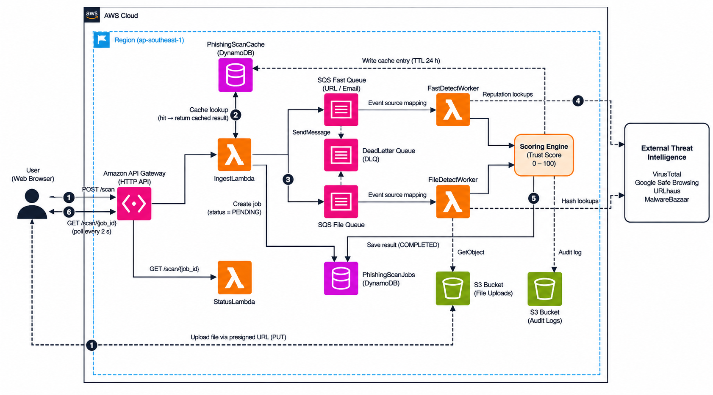

#### What Trust Check is

Trust Check checks a link, an email or a file for signs of phishing or malware. Instead of a plain "safe" or "unsafe", it gives you a trust score from 0 to 100 and tells you why points were deducted.

| Score | Level |
|---|---|
| 80 – 100 | SAFE |
| 50 – 79 | SUSPICIOUS |
| below 50 | DANGEROUS |

Each result also has a `confidence` field (HIGH, MEDIUM, LOW) showing how many reputable external sources answered. A SAFE score with LOW confidence only means no bad signs were found. It does not mean the content is confirmed safe.

#### What you will build

+ **API Gateway (HTTP API):** receives `POST /scan` and `GET /scan/{job_id}`.
+ **Lambda (Python 3.12):** four functions: `IngestLambda`, `StatusLambda`, `FastDetectWorker`, `FileDetectWorker`.
+ **SQS:** `phishing-fast-queue` for links and emails, `phishing-file-queue` for files, and `phishing-dlq` for failed messages.
+ **DynamoDB:** `PhishingScanJobs` for job state and results, `PhishingScanCache` for cached results with a TTL.
+ **S3:** a bucket that receives files uploaded by users through presigned URLs.
+ **Systems Manager Parameter Store (optional):** stores API keys as `SecureString`.
+ **CloudWatch:** logs and metrics.
+ **A web frontend** written in HTML, CSS and JavaScript, running on your own machine.

Outside AWS, the system also calls VirusTotal, Google Safe Browsing, URLhaus, MalwareBazaar and RDAP, all on free tiers.

#### By the end you will

+ Understand what each service does and why links and emails are handled separately from files.
+ Have deployed a complete serverless system in the AWS Console.
+ Have tested it with sample links, emails and files, and read the score and reasons.
+ Know where to look at logs, metrics and the dead-letter queue in CloudWatch and SQS.
+ Have deleted every resource when you are done.

#### General information

+ **Region:** Singapore (`ap-southeast-1`).
+ **Time:** about 2 to 3 hours (estimate).
+ **Cost:** all services are pay-per-use and at workshop scale should mostly fit in the AWS Free Tier. Still check your Billing page and do section 5.6 when you finish.

#### What is not included

The workshop follows the current source code, so a few limits apply:

+ ClamAV only runs when the environment has `clamscan`. On regular Lambda it is skipped.
+ YARA is a hand-written byte-string rule set, not the real YARA library.
+ Email analysis uses English and Vietnamese rules, not a machine learning model.
+ SPF, DKIM and DMARC are read from the email headers you paste in. The system does not query DNS itself.
+ There is no PDF report export and no user login.

