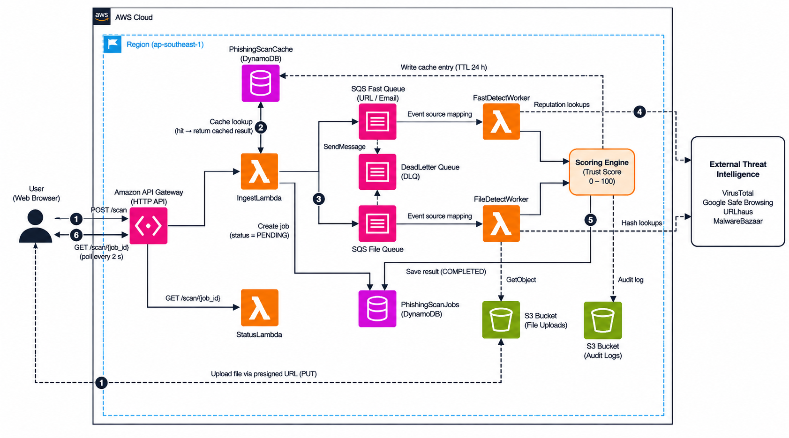

#### Kiến trúc tổng quan

Trust Check là hệ thống serverless hướng sự kiện. Yêu cầu quét đi qua API Gateway tới một Lambda tiếp nhận, được đưa vào hàng đợi SQS để các worker xử lý bất đồng bộ, và kết quả được lưu vào DynamoDB để giao diện web truy vấn lại.

#### Các thành phần

| Thành phần | Vai trò |
|---|---|
| Amazon API Gateway (HTTP API) | Cung cấp hai tuyến: `POST /scan` để gửi yêu cầu và `GET /scan/{job_id}` để lấy kết quả |
| `IngestLambda` | Kiểm tra đầu vào, tra bộ đệm, tạo job và đẩy vào hàng đợi phù hợp |
| `StatusLambda` | Đọc trạng thái và kết quả của một job từ DynamoDB |
| `FastDetectWorker` | Phân tích link và email, nhận việc từ hàng đợi fast |
| `FileDetectWorker` | Phân tích file đã tải lên S3, nhận việc từ hàng đợi file |
| Amazon SQS | Ba hàng đợi: fast, file và hàng đợi lỗi (DLQ) |
| Amazon DynamoDB | Bảng `PhishingScanJobs` lưu job và kết quả, bảng `PhishingScanCache` lưu kết quả dùng lại |
| Amazon S3 | Nhận file người dùng tải lên qua presigned URL |
| AWS Systems Manager Parameter Store | Lưu các khóa API dưới dạng `SecureString` với tiền tố `/phishing/` |
| AWS IAM | Cấp cho mỗi Lambda quyền tối thiểu trên đúng tài nguyên cần dùng |
| Amazon CloudWatch | Lưu log của các Lambda |

Các Lambda dùng Python 3.12 trên kiến trúc arm64. Hai worker có thể bổ sung kết quả từ VirusTotal, Google Safe Browsing và URLhaus cho phần phân tích nội bộ.

#### Luồng dữ liệu

1. Giao diện web gửi `POST /scan` với `type` là `link`, `email` hoặc `file`, kèm `payload`.
2. API Gateway chuyển yêu cầu tới `IngestLambda`. Hàm kiểm tra đầu vào và trả lỗi `400` nếu không hợp lệ.
3. Với link và email, hàm băm nội dung bằng SHA-256 và tra bảng `PhishingScanCache`. Nếu đã có kết quả còn hạn, hàm trả về ngay.
4. Nếu chưa có, hàm tạo một job trong bảng `PhishingScanJobs` với trạng thái chờ xử lý, rồi gửi tin nhắn vào hàng đợi. Link và email vào hàng đợi fast. File vào hàng đợi file, và phản hồi có thêm `upload_url` để giao diện tải file lên S3.
5. Worker nhận tin nhắn, phân tích nội dung, tính điểm tin cậy và ghi kết quả vào job. Với file, `FileDetectWorker` chờ tối đa 30 giây để file xuất hiện trên S3.
6. Giao diện gọi `GET /scan/{job_id}` theo chu kỳ. `StatusLambda` trả về trạng thái, và khi job hoàn tất thì trả kèm kết quả.

Tin nhắn xử lý thất bại nhiều lần được chuyển sang hàng đợi lỗi để không làm kẹt hàng đợi chính.

#### Kết quả phân tích

Mỗi kết quả có điểm tin cậy từ 0 đến 100 và mức độ rủi ro tương ứng:

| Điểm | Mức rủi ro |
|---|---|
| 80 trở lên | `SAFE` |
| 50 đến 79 | `SUSPICIOUS` |
| Dưới 50 | `DANGEROUS` |

Kết quả còn có độ tin cậy `HIGH`, `MEDIUM` hoặc `LOW`. Khi phân tích gặp lỗi, mức rủi ro là `SCAN ERROR`. Kết quả có độ tin cậy `LOW` và `SCAN ERROR` không được lưu vào bộ đệm. Các kết quả còn lại được giữ 24 giờ nhờ thuộc tính `expires_at` của DynamoDB TTL.

#### Vì sao chọn kiến trúc này

- **Bất đồng bộ:** API trả lời ngay bằng `job_id`, còn phần phân tích tốn thời gian chạy ở worker, nên một yêu cầu chậm không chặn các yêu cầu khác.
- **Tách tải:** link, email và file có hàng đợi và worker riêng, mỗi loại mở rộng độc lập.
- **Chi phí theo mức dùng:** toàn bộ dịch vụ tính phí theo lượng sử dụng, không có máy chủ chạy liên tục.
- **Bảo mật:** file đi thẳng từ trình duyệt lên S3 qua presigned URL, khóa API nằm trong Parameter Store thay vì mã nguồn, và mỗi Lambda chỉ có quyền cần thiết.