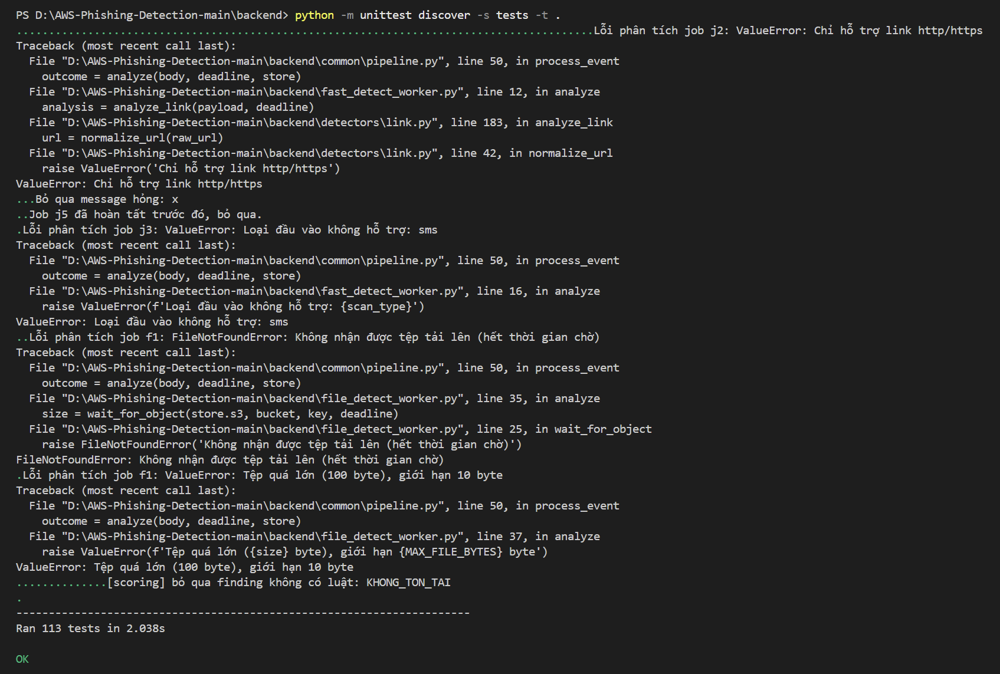

Trước khi tạo tài nguyên trên AWS, cần xác nhận mã nguồn chạy đúng trên máy cục bộ và đóng gói sẵn file triển khai cho hai hàm worker.

#### Chạy bộ kiểm thử

Mở PowerShell, di chuyển vào thư mục `backend` của mã nguồn đã clone ở mục 5.2 và chạy:

    cd AWS-Phishing-Detection\backend
    python -m unittest discover -s tests -t .

Bộ kiểm thử không yêu cầu kết nối mạng hay tài khoản AWS. Kết quả thành công kết thúc bằng dòng `Ran ... tests` và `OK`.

Trong kết quả có thể xuất hiện các dòng `Traceback`. Đây là log của những ca kiểm thử lỗi được thiết kế có chủ đích, không phải lỗi thật. Kết quả được xác định bởi dòng cuối cùng.

#### Đóng gói file triển khai

Trong thư mục `backend`, chạy:

    python build_zip.py

Lệnh tạo file `dist\detect-workers.zip` (khoảng 33 KB). Gói chứa hai handler `fast_detect_worker.py` và `file_detect_worker.py` ở thư mục gốc của zip, cùng hai thư mục `common` và `detectors`.

Hai hàm `FastDetectWorker` và `FileDetectWorker` dùng chung gói này. `IngestLambda` và `StatusLambda` mỗi hàm là một file Python đơn, `backend\ingest_lambda.py` và `backend\status_lambda.py`, không cần đóng gói.

#### Kết quả

+ Bộ kiểm thử hoàn tất với trạng thái `OK`.
+ File `backend\dist\detect-workers.zip` đã được tạo.