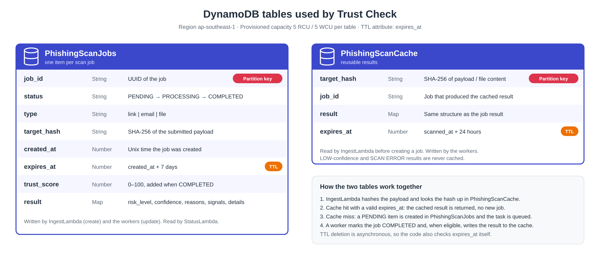

Hệ thống dùng hai bảng DynamoDB: `PhishingScanJobs` lưu từng job quét và kết quả, `PhishingScanCache` lưu kết quả để tái sử dụng trong 24 giờ.

#### Tạo bảng PhishingScanJobs

1. Mở AWS Console, chọn Region **Asia Pacific (Singapore) ap-southeast-1**.
2. Mở dịch vụ **DynamoDB**, chọn **Tables** ở menu bên trái, rồi chọn **Create table**.
3. Nhập thông tin:
   + **Table name:** `PhishingScanJobs`
   + **Partition key:** `job_id`, kiểu **String**
   + Không khai báo sort key.
4. Ở **Table settings**, chọn **Customize settings**.
5. Ở **Read/write capacity settings**, chọn **Provisioned**. Với cả **Read capacity** và **Write capacity**, đặt **Auto scaling** là **Off** và **Provisioned capacity units** là `5`.
6. Chọn **Create table**. Đợi trạng thái bảng chuyển sang **Active**.

#### Tạo bảng PhishingScanCache

Lặp lại các bước trên với thông tin sau:

+ **Table name:** `PhishingScanCache`
+ **Partition key:** `target_hash`, kiểu **String**
+ **Capacity mode:** Provisioned, Read `5`, Write `5`, Auto scaling **Off**

Mức 5 RCU và 5 WCU cho mỗi bảng nằm trong hạn mức miễn phí vĩnh viễn của DynamoDB (tổng 25 RCU và 25 WCU), phù hợp quy mô workshop.

#### Bật TTL cho cả hai bảng

TTL cho phép DynamoDB tự xóa các mục đã hết hạn. Cả hai bảng dùng chung tên thuộc tính `expires_at`, lưu thời điểm hết hạn dưới dạng Unix time (giây).

Thực hiện lần lượt với từng bảng:

1. Chọn tên bảng để mở trang chi tiết.
2. Mở tab **Additional settings**.
3. Ở mục **Time to Live (TTL)**, chọn **Turn on**.
4. Nhập **TTL attribute name:** `expires_at`, rồi chọn **Turn on TTL**.

| Bảng | Giá trị `expires_at` |
|---|---|
| `PhishingScanJobs` | Thời điểm tạo job cộng 7 ngày |
| `PhishingScanCache` | Thời điểm quét cộng 24 giờ |

DynamoDB xóa mục hết hạn theo cơ chế nền, có thể chậm hơn thời điểm hết hạn. Vì vậy mã nguồn luôn tự kiểm tra `expires_at` trước khi dùng kết quả trong bộ đệm, không dựa vào việc mục đã bị xóa hay chưa.

#### Kết quả

+ Hai bảng `PhishingScanJobs` và `PhishingScanCache` ở trạng thái **Active** trong Region Singapore.
+ Cả hai đều bật TTL trên thuộc tính `expires_at`.
