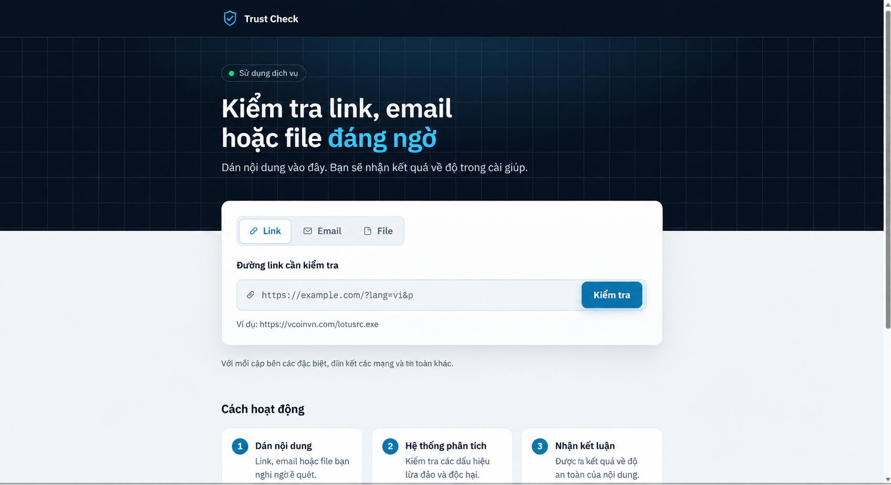

The Trust Check web frontend is a static page written in HTML, CSS and JavaScript, located in the `frontend` folder of the source code. In this workshop it runs on the local machine and calls the API created in section 5.4.7.

#### Configure the API address

The API address is declared in the file `frontend\js\config.js`.

1. Open `frontend\js\config.js` in Visual Studio Code.
2. Replace the `API_BASE` value with the **Invoke URL** recorded in section 5.4.7, without a trailing `/`:

```javascript
const CONFIG = {
  API_BASE: "https://<api-id>.execute-api.ap-southeast-1.amazonaws.com",

  POLL_INTERVAL_MS: 2000,
  POLL_MAX_ATTEMPTS: { link: 30, email: 30, file: 45 },

  MAX_FILE_MB: 10,
  MAX_URL_CHARS: 2048,
  MAX_EMAIL_CHARS: 20000,
};
```

3. Save the file.

This file holds public information only. Never put AWS keys, API keys or passwords in it.

#### Run the frontend

Open PowerShell, change to the `frontend` folder and start a simple web server:

    cd AWS-Phishing-Detection\frontend
    python -m http.server 8000

Open a browser and go to:

    http://localhost:8000/index.html

The port must be `8000` and the address must be `localhost`, because the CORS configuration of the S3 bucket in section 5.4.3 allows only the origin `http://localhost:8000`. Using another address (for example `127.0.0.1`) makes the browser block file uploads.

If the browser still shows an old version of the page, press `Ctrl + F5` to reload without the cache.



#### What the interface provides

The interface has three tabs:

| Tab | Input | Limit |
|---|---|---|
| Link | A URL | Up to 2048 characters |
| Email | The full email content. Paste the headers as well so SPF, DKIM and DMARC can be checked | Up to 20,000 characters |
| File | A file chosen from the machine | Up to 10 MB |

After submission, the interface asks for the result every 2 seconds until the job completes or the maximum number of attempts is reached.

#### Result

+ The page `http://localhost:8000/index.html` opens and shows the three tabs Link, Email and File.
+ `API_BASE` in `config.js` points to the Invoke URL of the API that was created.
+ The system is ready for testing in section 5.5.