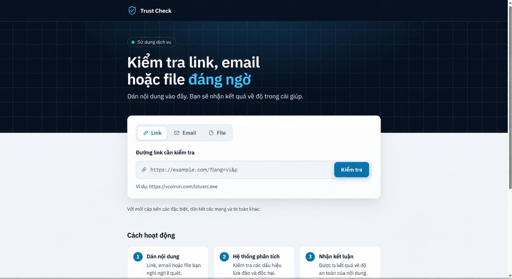

Giao diện web của Trust Check là một trang tĩnh viết bằng HTML, CSS và JavaScript, nằm trong thư mục `frontend` của mã nguồn. Trong workshop, trang này chạy trên máy cục bộ và gọi tới API đã tạo ở mục 5.4.7.

#### Cấu hình địa chỉ API

Địa chỉ API được khai báo trong file `frontend\js\config.js`.

1. Mở file `frontend\js\config.js` trong Visual Studio Code.
2. Thay giá trị `API_BASE` bằng **Invoke URL** đã ghi lại ở mục 5.4.7, không có dấu `/` ở cuối:

```javascript
const CONFIG = {
  API_BASE: "https://<api-id>.execute-api.ap-southeast-1.amazonaws.com",

  POLL_INTERVAL_MS: 2000,
  POLL_MAX_ATTEMPTS: { link: 30, email: 30, file: 45 },

  MAX_FILE_MB: 10,
  MAX_URL_CHARS: 2048,
  MAX_EMAIL_CHARS: 20000,
};
```

3. Lưu file.

File này chỉ chứa thông tin công khai. Không đặt khóa AWS, API key hay mật khẩu vào đây.

#### Chạy giao diện

Mở PowerShell, di chuyển vào thư mục `frontend` và chạy một máy chủ web đơn giản:

    cd AWS-Phishing-Detection\frontend
    python -m http.server 8000

Mở trình duyệt và truy cập:

    http://localhost:8000/index.html

Cổng phải là `8000` và địa chỉ phải là `localhost`, vì CORS của bucket S3 ở mục 5.4.3 chỉ cho phép nguồn `http://localhost:8000`. Truy cập bằng địa chỉ khác (ví dụ `127.0.0.1`) sẽ làm việc tải file lên bị trình duyệt chặn.

Nếu trình duyệt vẫn hiện bản cũ của trang, nhấn `Ctrl + F5` để tải lại không dùng bộ nhớ đệm.



#### Giao diện cung cấp

Giao diện có ba tab:

| Tab | Đầu vào | Giới hạn |
|---|---|---|
| Link | Một đường dẫn | Tối đa 2048 ký tự |
| Email | Toàn bộ nội dung email. Nên dán cả phần header để kiểm tra được SPF, DKIM, DMARC | Tối đa 20.000 ký tự |
| File | Một tệp chọn từ máy | Tối đa 10 MB |

Sau khi gửi, giao diện hỏi kết quả mỗi 2 giây cho đến khi job hoàn tất hoặc hết số lần chờ tối đa.

#### Kết quả

+ Trang `http://localhost:8000/index.html` mở được và hiển thị ba tab Link, Email, File.
+ `API_BASE` trong `config.js` trỏ tới Invoke URL của API đã tạo.
+ Hệ thống đã sẵn sàng để kiểm thử ở mục 5.5.