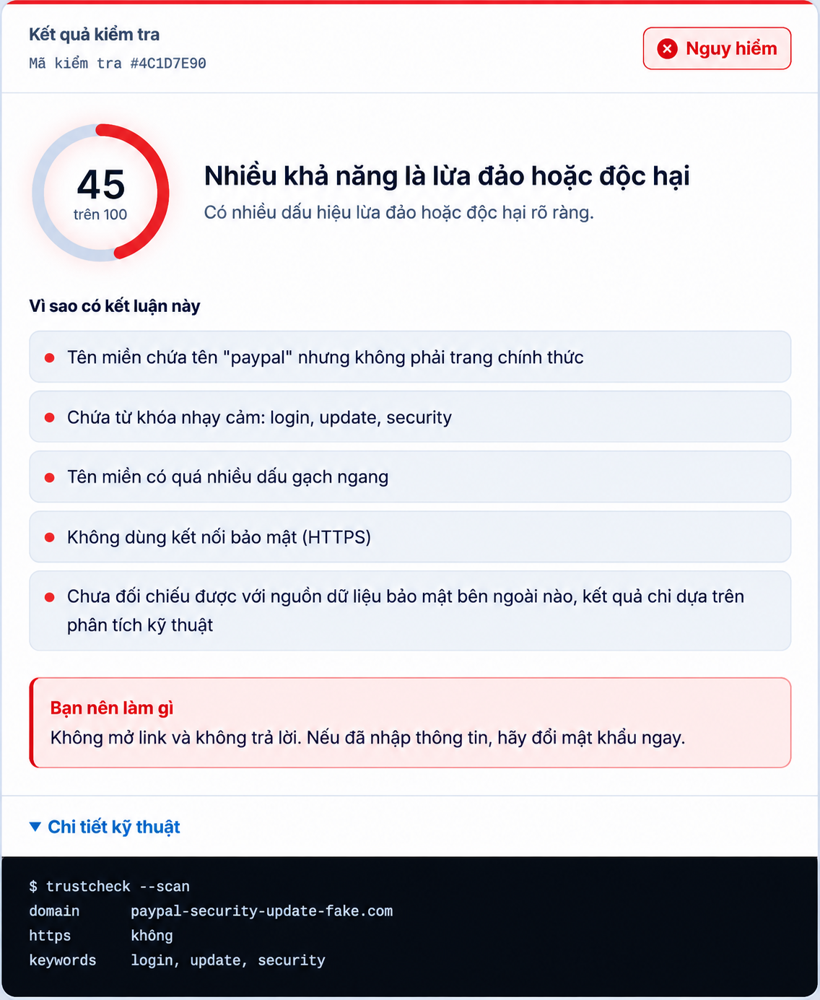
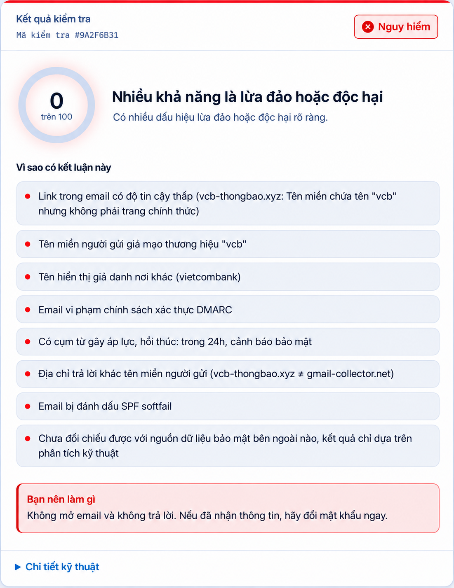
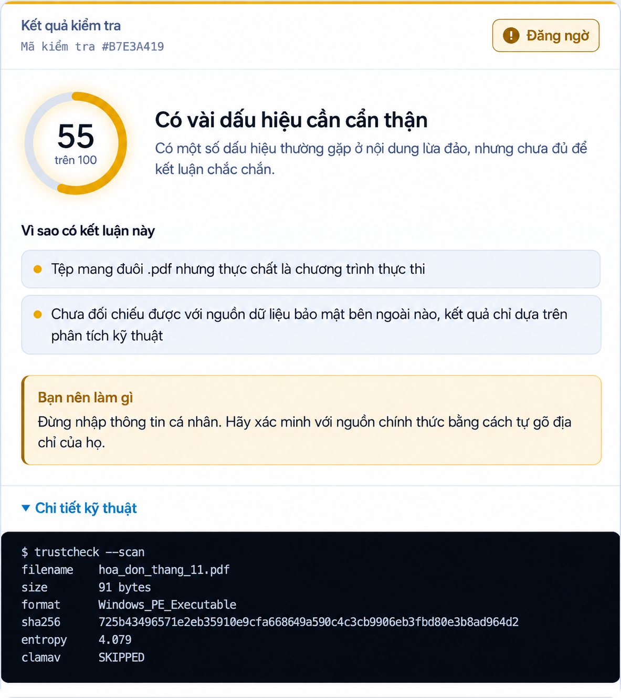

This section tests the three scanning flows of the system with harmless samples: a link, an email and a file. The web frontend started in section 5.4.9 is used for the main part. The last part tests the API directly.

#### Prepare the test samples

The sample link and email are already in the source code (`backend\samples`). The two sample files must be created with PowerShell, in a folder of your choice:

```powershell
mkdir workshop-samples
cd workshop-samples
Set-Content -Path ghi_chu.txt -Value "Bien ban hop nhom. Noi dung: ke hoach workshop." -Encoding ascii
Set-Content -Path hoa_don_thang_11.pdf -Value "MZ This is an inert text file used only for testing the file scanner. It is not a program." -Encoding ascii
```

+ `ghi_chu.txt` is plain text, used as a safe sample.
+ `hoa_don_thang_11.pdf` is actually a harmless text file that begins with the characters `MZ`, the signature of a Windows executable. It simulates a file with a disguised extension.

#### How to read a result

| Score | Risk level |
|---|---|
| 80 and above | `SAFE` |
| 50 to 79 | `SUSPICIOUS` |
| below 50 | `DANGEROUS` |

A result also has `confidence` (`HIGH`, `MEDIUM`, `LOW`) showing how many external sources answered. A `SAFE` result with `LOW` confidence only means no bad signs were found and nothing was cross-checked with an external source. When the API keys from section 5.4.6 or 5.4.8 are configured, `confidence` is usually higher.

#### Test a link scan

1. Open `http://localhost:8000/index.html` and choose the **Link** tab.
2. Paste `http://paypal-security-update-fake.com/login` and submit.
3. Wait for the result (a few seconds up to about a minute).

Expected result: risk level `DANGEROUS`. Typical reasons: the domain contains the name "paypal" but is not the official site, it contains sensitive keywords (login, update, security), the domain has too many hyphens, and HTTPS is not used.



Control sample: scan `https://example.com`. The expected result is `SAFE`.

#### Test an email scan

1. Open `backend\samples\email_lua_dao.txt` in Visual Studio Code, select all the content and copy it.
2. In the web frontend, choose the **Email** tab, paste the content and submit.

Expected result: risk level `DANGEROUS`. Typical reasons: the sender domain impersonates a brand, the display name impersonates another organisation, the email fails the DMARC policy, it contains pressure phrases, and the reply address differs from the sender domain.



Control sample: scan the content of `backend\samples\email_binh_thuong.txt`. The expected result is `SAFE`.

#### Test a file scan

1. In the web frontend, choose the **File** tab.
2. Select the file `hoa_don_thang_11.pdf` and submit.

Expected result: risk level `SUSPICIOUS`, with the reason that the file has a `.pdf` extension but is actually an executable program.



Control sample: scan the file `ghi_chu.txt`. The expected result is `SAFE`.

#### Test directly through the API

This part tests the asynchronous flow without the web frontend. Replace `<INVOKE_URL>` with the address recorded in section 5.4.7.

**Scan a link and follow the status:**

```powershell
$base = "<INVOKE_URL>"
$job = Invoke-RestMethod -Uri "$base/scan" -Method Post -ContentType "application/json" `
  -Body '{"type":"link","payload":"http://paypal-security-update-fake.com/login"}'
$job

do {
  Start-Sleep 5
  $r = Invoke-RestMethod -Uri "$base/scan/$($job.job_id)"
  $r.status
} while ($r.status -ne "COMPLETED")

$r.result.risk_level
$r.result.confidence
$r.result.reasons
```

The job status goes through `PENDING`, `PROCESSING` and then `COMPLETED`. Numeric values in the `StatusLambda` response can appear as strings (for example `"45"`), so convert them when using them in code.

**Scan a file (two steps):** the system returns an `upload_url` valid for 5 minutes. Upload the file to that address immediately, then ask for the result as usual.

```powershell
$path = (Resolve-Path .\hoa_don_thang_11.pdf).Path
$job = Invoke-RestMethod -Uri "$base/scan" -Method Post -ContentType "application/json" `
  -Body (@{type="file"; payload=(Split-Path $path -Leaf)} | ConvertTo-Json)
Invoke-RestMethod -Uri $job.upload_url -Method Put -InFile $path -ContentType "application/octet-stream"

do {
  Start-Sleep 5
  $r = Invoke-RestMethod -Uri "$base/scan/$($job.job_id)"
  $r.status
} while ($r.status -ne "COMPLETED")
$r.result.risk_level
```

#### Result

| Sample | Expected risk level |
|---|---|
| Link `paypal-security-update-fake.com` | `DANGEROUS` |
| Link `example.com` | `SAFE` |
| Email `email_lua_dao.txt` | `DANGEROUS` |
| Email `email_binh_thuong.txt` | `SAFE` |
| File `hoa_don_thang_11.pdf` | `SUSPICIOUS` |
| File `ghi_chu.txt` | `SAFE` |

The exact score may differ depending on the data returned by the external sources. The risk level is the main criterion to compare.